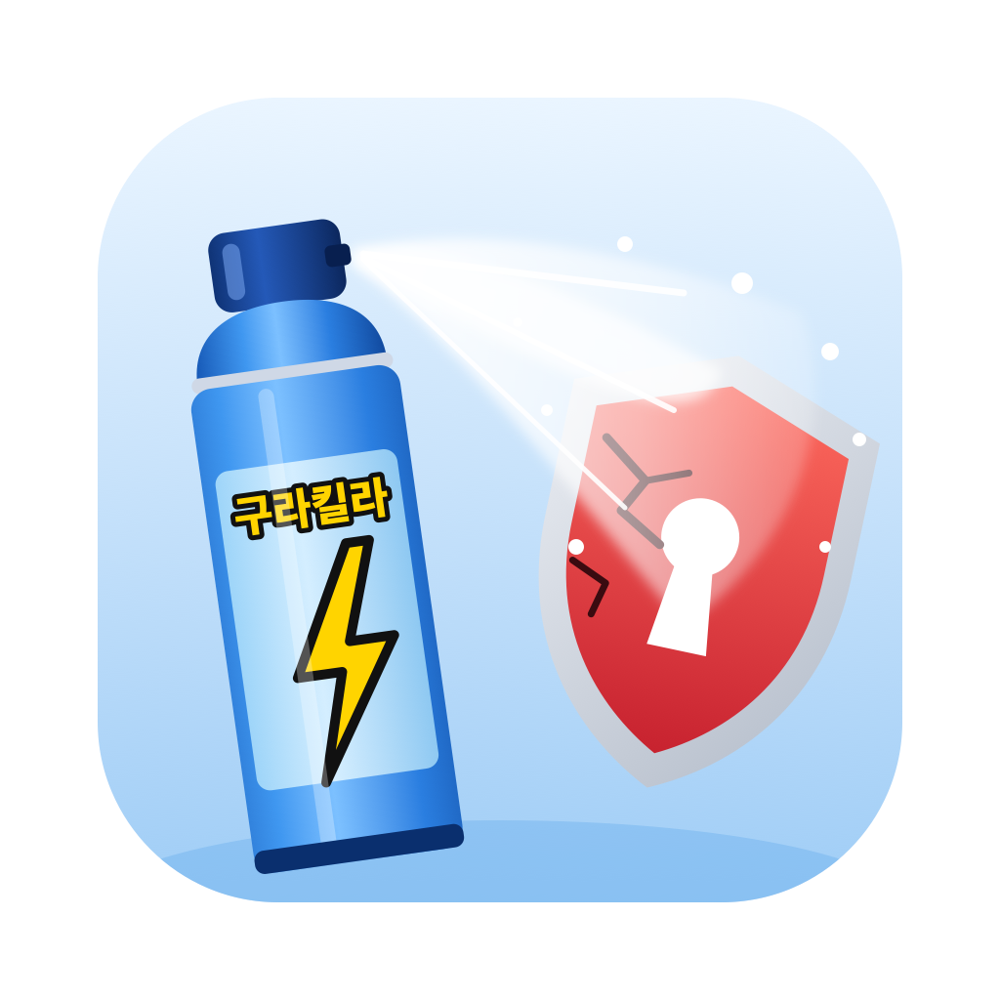
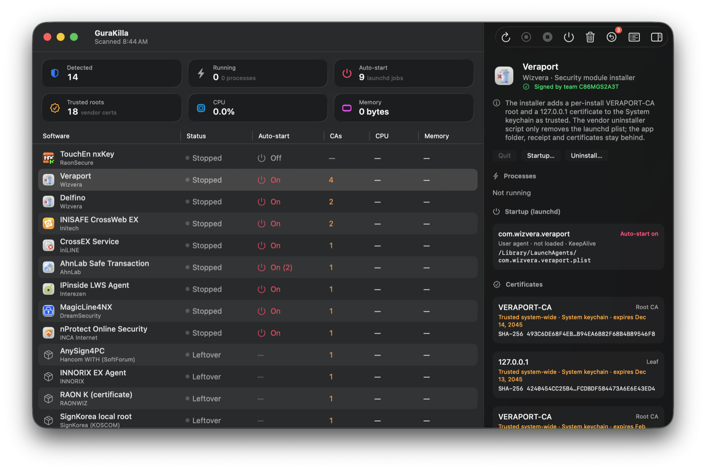

# GuraKilla (구라킬라)

[한국어](README.md) | **English**

A macOS app for checking and cleaning up the security software that Korean banking and government
sites install: TouchEn nxKey, Veraport, Delfino, INISAFE CrossWeb EX, CrossEX, AhnLab Safe Transaction,
IPinside, MagicLine4NX, nProtect, AnySign4PC, and the files they leave behind.

Swift + SwiftUI, macOS 26, Apple silicon and Intel. No dependencies.



## Download

Get the latest `.dmg` from [Releases](https://github.com/hjun1052/gurakilla/releases/latest). Requires macOS 26 or later
(universal). The app is ad-hoc signed and not notarized: open it the first time with right-click → Open, or
System Settings → Privacy & Security → Open Anyway.

## Build

```sh
xcodegen generate            # project.yml → GuraKilla.xcodeproj
xcodebuild -project GuraKilla.xcodeproj -scheme GuraKilla -configuration Release -derivedDataPath build build
open build/Build/Products/Release/GuraKilla.app
```

Tests (unit + one regression case per supported product):

```sh
xcodebuild -project GuraKilla.xcodeproj -scheme GuraKilla -destination 'platform=macOS,arch=arm64' -derivedDataPath build test
```

Read-only scan from the command line (JSON):

```sh
build/Build/Products/Release/GuraKilla.app/Contents/MacOS/GuraKilla --scan-json
```

Removal from the command line. It prints the same plan the Uninstall sheet shows and is a dry run unless you add `--yes`.
Admin steps use the macOS password dialog, or `sudo -n` with `--sudo` (fails instead of prompting if sudo isn't already authorized):

```sh
build/Build/Products/Release/GuraKilla.app/Contents/MacOS/GuraKilla --remove wizvera-veraport          # show plan
build/Build/Products/Release/GuraKilla.app/Contents/MacOS/GuraKilla --remove wizvera-veraport --yes    # do it
```

## What it does

- **Detects** products by code-signing Team ID, vendor install folder, launchd label, package receipt,
  certificate subject and system extension ID. It does not match on names alone.
- **Shows** running processes (CPU, memory, PID, owner, real executable path), launchd jobs, auto-start state,
  trusted root certificates, kernel/system extensions, files and receipts.
- **Quit**: asks the process to quit first and re-checks the PID before acting. Root-owned processes need admin
  approval. KeepAlive jobs that launchd restarts right away are marked as such.
- **Manage Startup**: uses `launchctl disable/enable`. Vendor plist files are not modified.
- **Uninstall**: recommends the vendor uninstaller if there is one; otherwise shows a list of items to pick from.
  Files go to the Trash and certificates are backed up before deletion. Items shared with other software start
  unchecked. Kernel and system extensions are not removed.
- **Restore Settings**: undoes startup changes, moved files and removed certificates.
- **Audit log**: every action is written to `~/Library/Logs/GuraKilla/audit.log`.

Admin actions show the commands first, then use the standard macOS password prompt. The app does not see the
password. macOS may ask again when clearing a certificate's system-wide trust. The certificate is already deleted
by then, so cancelling at that point does not leave a trusted root behind.

GuraKilla does not modify SIP, Endpoint Security, MDM or Apple components.

## Languages

English and Korean (한국어). The app follows the macOS language order; to force Korean for GuraKilla only, use
System Settings › General › Language & Region › Applications. UI strings live in
`GuraKilla/Resources/Localizable.xcstrings`; publishers, categories and notes in `Products.xcstrings`. Product names
stay as the vendors write them (the same names Korean banks show). `--scan-json` and the `--remove` plan output stay in English;
audit log action codes are English, with details in the language the app was running in. `LocalizationTests` fails if a string has no Korean translation.

## Extending the registry

Add products without rebuilding: `~/Library/Application Support/GuraKilla/registry.json`, a JSON array with the
same fields as `ProductDefinition` in `GuraKilla/Engine/Registry.swift` (an entry with an existing `id` replaces it).

## Research

`research/` has the notes behind the registry: system baseline, official installer analysis, uninstaller
behaviour, cleanup verification, a compatibility matrix and install → remove tests of six products in throwaway
macOS VMs (`research/vm-test/`). Start with `research/README.md`.
