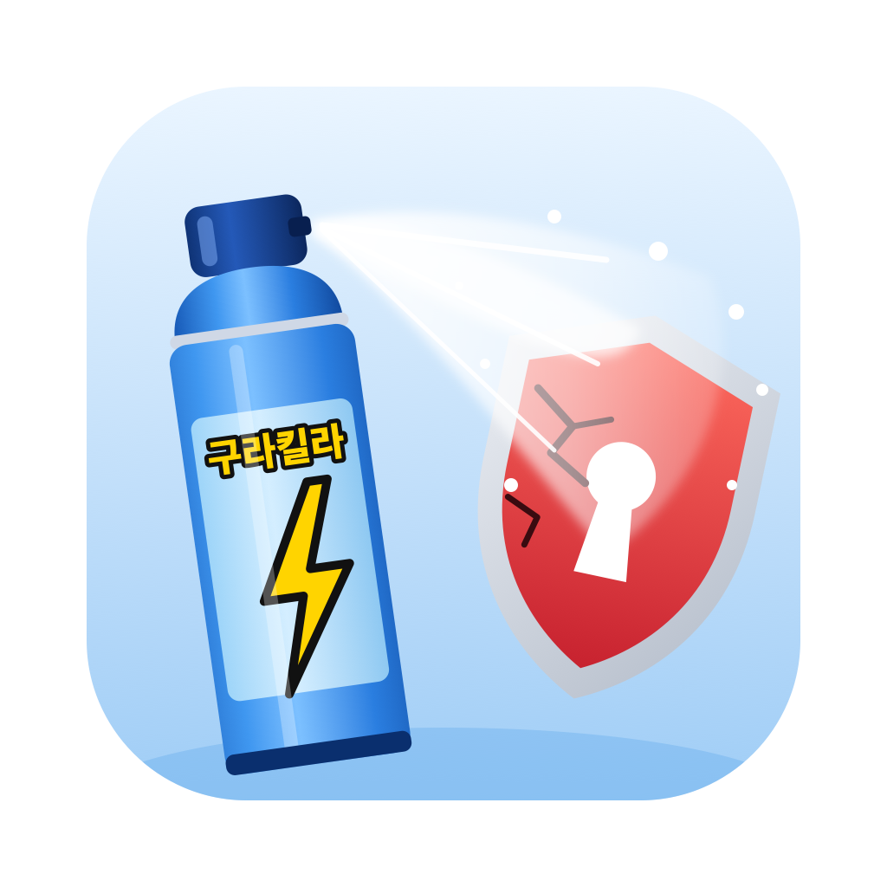
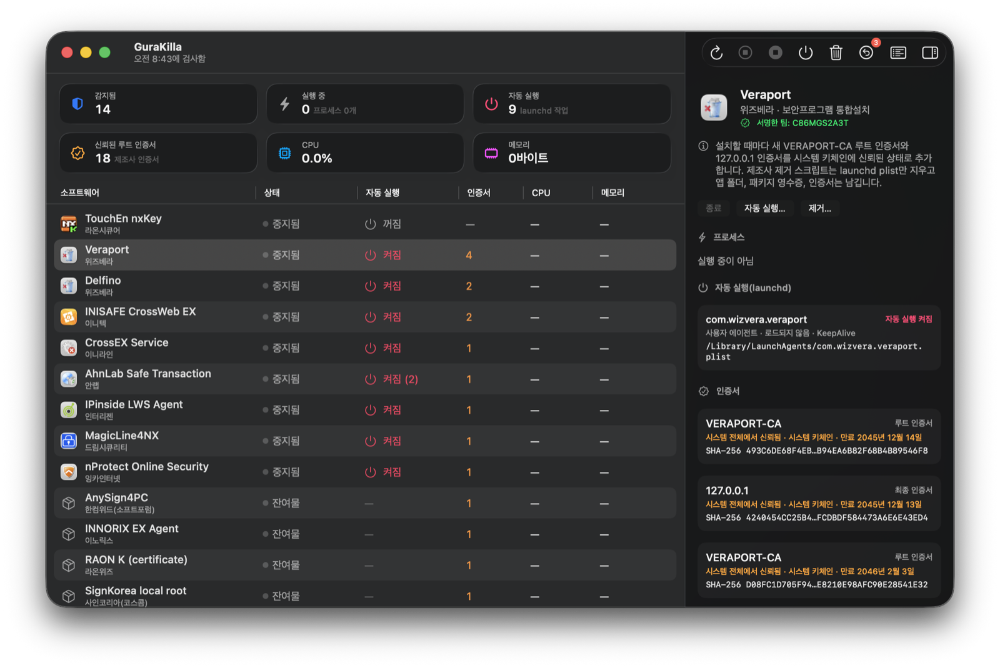

# GuraKilla (구라킬라)

**한국어** | [English](README.en.md)

은행·공공기관 웹사이트 이용 시 설치되는 보안 프로그램을 확인하고 정리하는 macOS 앱.

대상: TouchEn nxKey, Veraport, Delfino, INISAFE CrossWeb EX, CrossEX, AhnLab Safe Transaction, IPinside,
MagicLine4NX, nProtect, AnySign4PC 및 제거 후 남은 파일.

- macOS 26 이상, Apple 실리콘 / Intel
- Swift, SwiftUI. 외부 라이브러리 없음



## 다운로드

[Releases](https://github.com/hjun1052/gurakilla/releases/latest)에서 `.dmg` 파일을 내려받음.

공증을 받지 않은 앱이므로 첫 실행 시 macOS가 실행을 차단함. 오른쪽 클릭 → 열기로 실행하거나,
시스템 설정 → 개인정보 보호 및 보안 → 그래도 열기를 선택함.

## 업데이트

1.0.2부터 앱이 하루 한 번 새 버전을 확인하고, 새 버전이 있으면 창 상단에 알림을 표시함. 업데이트 버튼을 누르면
새 버전을 내려받아 교체한 뒤 다시 실행함. 앱 메뉴 → 업데이트 확인…으로 직접 확인할 수도 있음.

- 릴리스 zip은 Ed25519 키로 서명되며, 앱에 포함된 공개 키로 서명을 확인한 뒤에만 설치함. 서명이 맞지 않으면 설치하지 않음.
- 앱이 응용 프로그램 폴더처럼 쓰기 가능한 위치에 있어야 자동 교체가 가능함. 그렇지 않으면 릴리스 페이지를 안내함.
- 1.0.1 이하 버전은 업데이트 기능이 없으므로 한 번은 직접 설치해야 함.

## 빌드

```sh
xcodegen generate            # project.yml → GuraKilla.xcodeproj
xcodebuild -project GuraKilla.xcodeproj -scheme GuraKilla -configuration Release -derivedDataPath build build
open build/Build/Products/Release/GuraKilla.app
```

테스트 (단위 테스트 및 제품별 회귀 테스트):

```sh
xcodebuild -project GuraKilla.xcodeproj -scheme GuraKilla -destination 'platform=macOS,arch=arm64' -derivedDataPath build test
```

명령줄 검사 (JSON 출력, 읽기 전용):

```sh
build/Build/Products/Release/GuraKilla.app/Contents/MacOS/GuraKilla --scan-json
```

명령줄 제거. 기본 동작은 제거 계획 출력이며, `--yes` 옵션을 지정해야 실제로 제거함.
관리자 권한이 필요한 단계에서는 macOS 암호 입력 창을 표시함. `--sudo` 옵션 지정 시 `sudo -n`을 사용하며,
sudo 인증이 되어 있지 않으면 암호를 묻지 않고 실패함.

```sh
build/Build/Products/Release/GuraKilla.app/Contents/MacOS/GuraKilla --remove wizvera-veraport          # 계획 출력
build/Build/Products/Release/GuraKilla.app/Contents/MacOS/GuraKilla --remove wizvera-veraport --yes    # 실행
```

릴리스 (관리자용). `project.yml`의 `MARKETING_VERSION`을 먼저 올리고 커밋한 뒤 실행함:

```sh
swift scripts/update-key.swift genkey   # 최초 1회. 서명용 개인 키를 로그인 키체인에 저장
scripts/release.sh 1.0.3 notes.md       # 빌드, dmg/zip 생성, zip 서명, GitHub 릴리스 게시
```

## 기능

- **검사**: 코드 서명 Team ID, 설치 폴더, launchd 레이블, 패키지 영수증, 인증서, 시스템 확장 ID로 제품을 식별함. 이름만으로 판단하지 않음.
- **상세 정보**: 프로세스(CPU, 메모리, PID, 소유자, 실행 파일 경로), launchd 작업, 자동 실행 여부, 루트 인증서, 커널/시스템 확장, 파일, 패키지 영수증을 표시함.
- **종료**: 정상 종료를 먼저 시도하고, 종료 전 PID를 다시 확인함. root 프로세스는 관리자 확인을 거침. launchd가 즉시 재실행하는 작업(KeepAlive)은 별도로 표시함.
- **자동 실행 관리**: `launchctl disable/enable`을 사용함. 제조사 plist 파일은 수정하지 않음.
- **제거**: 제조사 제거 프로그램이 있으면 이를 우선 권장함. 없으면 제거 목록을 표시하고 항목을 선택하게 함. 파일은 휴지통으로 이동하고, 인증서는 백업 후 삭제함. 다른 프로그램과 공유하는 항목은 기본적으로 선택 해제됨. 커널/시스템 확장은 제거하지 않음.
- **설정 복원**: 자동 실행 변경, 이동한 파일, 삭제한 인증서를 원래대로 되돌림.
- **감사 로그**: `~/Library/Logs/GuraKilla/audit.log`에 모든 작업을 기록함.

관리자 작업은 실행할 명령을 먼저 표시한 뒤 macOS 기본 암호 입력 창을 사용함. 앱은 암호에 접근하지 않음.
인증서 신뢰 해제 단계에서 macOS가 한 번 더 확인을 요청할 수 있음. 인증서는 이 단계 이전에 삭제되므로, 이 단계에서 취소하더라도 신뢰된 루트 인증서는 남지 않음.

SIP, Endpoint Security, MDM, Apple 구성 요소는 변경하지 않음.

## 언어

한국어와 영어를 지원하며 macOS 언어 설정을 따름. 이 앱에만 한국어를 적용하려면
시스템 설정 › 일반 › 언어 및 지역 › 응용 프로그램에서 지정함.

- UI 문자열: `GuraKilla/Resources/Localizable.xcstrings`
- 제조사, 분류, 설명: `Products.xcstrings`
- 제품 이름은 제조사 표기(은행 사이트에 표시되는 이름)를 그대로 사용함
- `--scan-json`, `--remove` 출력은 영어로 표시함
- 감사 로그의 동작 코드는 영어, 세부 내용은 실행 당시 앱 언어로 기록함
- 한국어 번역이 누락된 문자열이 있으면 `LocalizationTests`가 실패함

## 제품 추가

다시 빌드하지 않고 제품을 추가할 수 있음. `~/Library/Application Support/GuraKilla/registry.json`에 JSON 배열로 작성함.
필드 구성은 `GuraKilla/Engine/Registry.swift`의 `ProductDefinition`과 같음. `id`가 같은 항목은 기존 항목을 대체함.

## 조사 자료

`research/`: 레지스트리 작성 근거 자료. 시스템 기준선, 공식 설치 파일 분석, 제조사 제거 프로그램의 실제 동작,
정리 결과 검증, 호환성 표, 일회용 macOS VM에서 진행한 6개 제품 설치·제거 테스트(`research/vm-test/`)를 포함함.
`research/README.md`부터 참고 (영문).
